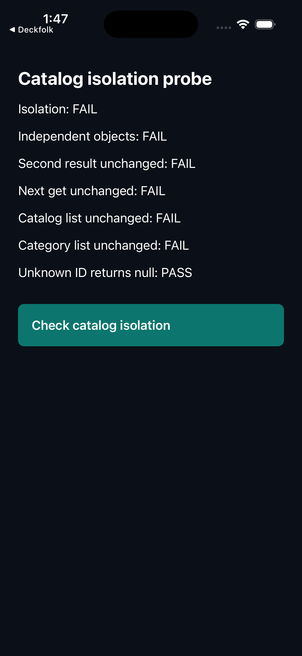
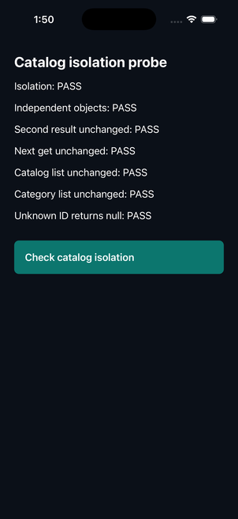

# Catalog isolation native probe — 2026-10-25

The unchanged original service reproduces the isolation defect. The exact accepted guided candidate passes all six tested checks, twice, on iPhone 17 Pro / iOS 26.5. This is narrow native behavior evidence, **not model qualification or measured Vectalon improvement**.

[Source-free native record](catalog-native-2026-10-25.json) binds the `catalog-get-isolation` guided repetition 1 candidate from [the frozen comparison](one-app-v2-comparison-2026-10-25.md). SHA-256: `70d3a6c4624ea8dcc51dc03da8b131dec41a9560b605b5103f9742ca0934f8ad`. No new inference, repair or candidate source edits. The first staging added a final newline; its build is retained as superseded, not runtime evidence. Exact response bytes were restored, hashed and rebuilt before candidate installation.

| Probe check | Original | Exact candidate, both invocations |
|---|---|---|
| Independent returned objects | Fail | Pass |
| Earlier returned product stays unchanged | Fail | Pass |
| Next lookup stays unchanged | Fail | Pass |
| Catalog list stays unchanged | Fail | Pass |
| Category list stays unchanged | Fail | Pass |
| Unknown ID returns null | Pass | Pass |

The disposable [probe](../../../scripts/experiments/catalog-isolation.native.tsx) exercises the real service via a button and visible results, without network calls. Its [UI acceptance test](../../../scripts/experiments/catalog-isolation.probe.acceptance.tsx) fails against the original service and passes against the candidate; these app checks are not the native evidence. Native evidence comes from simulator interaction screenshots and candidate accessibility inspection. Probe source was authored after inference and was not in model context.

Expo 58.0.17 / RN 0.88.0 / React 19.3.0, Release bundled JavaScript, signing disabled. Original and exact-candidate builds have zero errors, 31 and 28 warnings respectively. Only the disposable `in.vectalon.nativeproof` app was reinstalled before each variant, clearing its previous data. Existing temporary native workspace, dependencies and incremental build were reused; unreferenced source from previous probes remains there. Not a clean customer-app build, full catalog-screen acceptance, Android, hardware or signed-distribution qualification.

Recorded guardrails remain 100%; generic adherence remains 0%. Both task-only and guided conditions passed 3/3 app checks, so there is no observed completion advantage. No cost, human-effort or private held-out claim is supported. Temporary build/candidate records may expire; committed hashes and screenshots alone cannot reproduce generated source. Core/Admin, defaults and grants remain unchanged; no release.

## Independent rubric audit

[Six synthetic fixtures](../../../scripts/experiments/rubric-applicability-fixtures.json) and [unchanged results](rubric-applicability-2026-10-25.json) expose the `error-states` rule's lexical scope. Pure async services and the word `async` inside a string trigger a UI catch/error-state requirement. A UI example lacking error handling also fails; adding textual catch/error state satisfies that specific check. A rejected promise with no recognized async markers is unscored. These are lexical checks, not compilation or behavior evidence; other rubric checks may still fail.

No scoring rule, threshold or historical result was changed. Next correct applicability using independent service/UI and syntax fixtures, version the new evidence, and keep original failures/scores intact. A corrected rubric still cannot substitute for app/native acceptance or same-model improvement.
