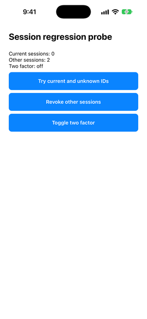
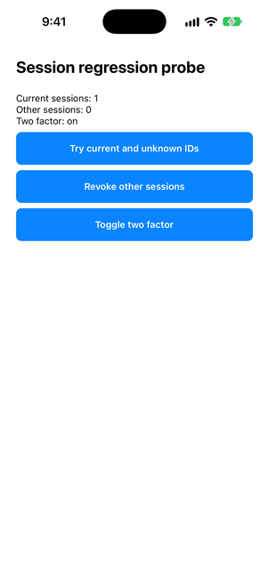

# Native session regression evidence — 2026-10-23

Result: the original hook reproduces the defect on an iOS Simulator; the exact task-only model candidate passes the tested native behavior. **No model qualification or Vectalon improvement is established.**

## Candidate and environment

- Frozen inference/app inputs: [complete source-free comparison](one-app-frozen-2026-10-23.json), app revision `7da3f6e52049980f53460d0ccfce35130e1763aa`, task `current-session`, condition `task-only`, repetition 2. One initial attempt, no model retry or assistant repair.
- Exact generated `src/hooks/useSecuritySettings.ts` content SHA-256: `53eff68e57e3f93795c9a059ebe5bf11aca68739b9dc460d8cb894c09fe32957`. Parsed artifact was copied mechanically, without edits, into a disposable app. Source inspected before execution; no filesystem/network operations were observed. It contains console logging and is not qualified for release.
- Qwen2.5-Coder-3B GGUF SHA-256: `724fb256bec1ff062b2f65e4569e871ad2e95ab2a3989723d1769c54294730b7`. The inference report recorded a matching observed file identity, not hardware/runtime attestation.
- Expo 58.0.17, React Native 0.88.0, React 19.3.0; Xcode 27.0 (27A266a), iPhone 18 Pro Simulator / iOS 27.0. Release configuration, bundled JavaScript, code signing disabled. No physical device, Android or distribution build tested.
- [Disposable probe](../../../scripts/experiments/current-session.native.tsx) replaces only temporary `App.tsx` and calls the evaluated hook directly. Probe UI was authored after inference to exercise the frozen behavioral requirement; it was not in model context. This is supplemental behavior evidence, not a full customer-screen or security audit.

## Native observations

Both installations started with one current session, two other sessions and two-factor off. Each installation cleared only the disposable `in.vectalon.nativeproof` app's data.

| Action | Original hook | Exact model candidate |
|---|---|---|
| Try current and unknown session IDs | Current sessions became **0**: defect reproduced | Current stayed **1**, other stayed **2** |
| Revoke both other sessions in one handler | Not run after defect reproduction | Current **1**, other **0** |
| Toggle two-factor | Not run after defect reproduction | **On**, session counts unchanged |

Release builds of original/probe and candidate/probe both succeeded with zero errors and 27 warnings each, including Expo module visibility and bundled-JavaScript global warnings. Build success did not conceal the original runtime defect.

## Interpretation and remaining limits

The candidate also passed the frozen app typecheck and full Jest checks, but scored **94.4% guardrails** due to console logging; adherence was **unscored**, not 100%. Native behavior does not override those gates. No candidate met the release qualification criteria. This success belongs to the task-only condition, not Vectalon guidance.

Across the three tasks, app-check passes were feature **0/3 vs 0/3**, fix **1/3 vs 0/3**, review **0/3 vs 0/3** (task-only vs guided). Three repetitions per condition in one public app cannot establish reliable improvement. The newly frozen tasks were not supplied with answers, but undisclosed pretraining exposure cannot be excluded. No seeds, actual token/cost accounting or human correction time were measured.

Observed failures: invalid parsing in all three task-only feature runs and two other task-only runs; guided feature outputs exceeded the allowed file scope twice and supplied non-TSX content once; guided fix outputs failed app checks; all guided review tests failed scope screening, while the other two parsed task-only review outputs failed compilation/tests. Raw model responses were not retained, so model output versus parser recovery cannot be conclusively separated. Do not tune these frozen answers or relabel repaired code as a first-attempt success.

Local build records: `/private/tmp/vectalon-expo58-native-Z5pg9t/session-negative.xcresult` and `session-model.xcresult`. Temporary build records and opt-in generated artifacts are not durable release archives; the source-free comparison, candidate hash and screenshots above are committed evidence. Simulator services were scoped to the test device for cleanup. Core/Admin and customer grants/data were unchanged; no package release.
