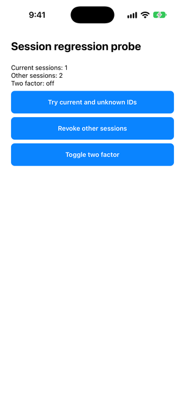

# RN development pilot

Observed development evidence, not model qualification or unseen-task improvement. Native evidence is separate from app checks and rubric scores; tokens/cost and human correction time are unmeasured.

Task: current-session · workflow: fix · app revision: 7da3f6e52049980f53460d0ccfce35130e1763aa

Model: qwen2.5-coder-7b · expected file SHA-256: 89f120544682078148c5a86117de9af3a65c339111262f2d3ff01d80d48b14be
Output-token cap: 2048 · attempt cap: 1 · grammar: required tool arguments: propose_edits

Anchor selection: module-and-direct-local-declarations. Source selection is not implementation correctness.

## Bounded resource protocol

direct native in both conditions  no router enrichment/fallback  default sampling unchanged

Row limit: 1. Remaining planned rows stay not-run. Reserve: 2147483648 bytes. Samples are estimates, not peak GPU/RAM or sustained-safety evidence.

| Condition | Repeat | Memory metric | Minimum available bytes | Maximum sampled RSS bytes | Input/output cap/context/batch tokens | Resource stop |
|---|---:|---|---:|---:|---|---|
| vectalon-edits | 1 | macos-pressure-estimate | 2748779069 | 3936370688 | 2153/2048/4608/128 | none observed |

## Outcome matrix

Check fractions count only recorded, non-skipped checks. Missing checks are not passes. App-check passes require matching model identity and both app checks; pending runs remain in the planned count. Passing app checks alone does not meet the release guardrail/adherence or native gates.

| Condition | Planned | App-check passes | Failed/error/timeout/incomplete | Pending | Typecheck passed/checked | Tests passed/checked |
|---|---:|---:|---:|---:|---:|---:|
| vectalon-edits | 3 | 0 | 1 | 2 | 0/0 | 0/0 |

## Repetitions and attempts

Attempt entries show kind: parsing / supplied verification. Unrecorded verification is not success. Attempt time includes in-loop verification but excludes final app checks; it is not total workflow latency.

| Condition | Repeat | Outcome | Identity | Typecheck | Tests | Attempts | Attempt ms | Run ms | Guardrails % | Adherence % | Native | Edit application |
|---|---:|---|---|---|---|---|---:|---:|---:|---:|---|---|
| vectalon-edits | 1 | failed | matched | skipped | skipped | initial: invalid / unrecorded | 27690 | 27708 | 0.0 | 0.0 | not-run | rejected |
| vectalon-edits | 2 | not-run | unrecorded | unrecorded | unrecorded | unrecorded | unrecorded | unrecorded | unscored | unscored | not-run | unrecorded |
| vectalon-edits | 3 | not-run | unrecorded | unrecorded | unrecorded | unrecorded | unrecorded | unrecorded | unscored | unscored | not-run | unrecorded |

## Original rejection versus post-processing-assisted result

| Stage | Native calls | Exact application | Compiler/app result |
|---|---:|---|---|
| Real run at `136d4c7` | 1 | Rejected because one byte-identical replacement was skipped | Not run; rejection retained |
| Offline replay at `d71eb7e` | 0 | One unchanged declaration counted; one real local edit applied | TypeScript passed; 36 tests / 15 suites passed, zero failed/skipped |

The original pinned 7B response completed in 27,680 ms native / 27,708 ms workflow and stopped with `stopGenerationTrigger`. It selected two smaller local declarations, not an entire hook. Both fragments parsed; one proposed declaration was identical to its original. Previously, that no-op caused a skipped-edit result and whole-proposal rejection. The original failed status, skipped app checks and two unstarted repetitions remain unchanged above.

The narrow normalization now counts byte-identical `replace` entries as unchanged only after validating the whole proposal's paths, shape, source anchors, uniqueness, non-overlap and syntax. Every real modification must still apply atomically. An all-no-op proposal remains invalid; unchanged entries cannot conceal an invalid edit. This does not relax app, guardrail or qualification thresholds. The new behavior had a failing-before-fix regression and is covered with real-change/no-op mixtures and invalid/all-no-op cases.

[Offline replay and independent app recheck](local-anchor-replay-2026-10-25.json) matched original task/request fingerprints and response hash. It produced candidate SHA-256 `3177e26edd322ec85bc9f1bd5e107fdfed514c0e7ea9ba115a99ddf092d24d1d`, which passed the unchanged compiler and full app suite in a fresh frozen export (`7da3f6e`) under sandbox isolation. The acceptance and dependency-lock hashes are retained. Fixture inputs were unchanged; generated source stayed in an opted-in local temporary report/export. This is a replay of one model response after a processing fix, not fresh inference or an original first-pass pass. Raw data in temporary local reports may expire; durable hashes alone do not reproduce it.

The accepted replay candidate scored 100% on applicable tested guardrails; generic adherence was unscored, not relabelled 100%. These scores do not establish universal safety or native correctness. Native build/device verification, fresh held-out tasks, repeated same-model comparisons and external customer acceptance remain open. No causal improvement or launch qualification is claimed.

Real-run input/context: 2,153/4,608 tokens; output cap 2,048, batch 128. Minimum sampled available-budget estimate about 2.56 GiB; maximum sampled process RSS about 3.67 GiB. Samples are not peak GPU/RAM measurements or sustained-operation qualification on the experimental 16 GiB host. Replaying/verifying the candidate used no model calls.

Local anchors cover only unique direct variable declarations inside top-level named function declarations. Parent/child overlaps, ambiguous/repeated source and unsupported deeper locals are refused/unoffered; existing module IDs stay stable. Source fragments and the composed module must parse. Arrow/class-body locals remain unqualified.

Next verify this exact candidate natively before expanding, then freeze fresh same-model tasks/repetitions. Do not continue tuning this known public fix to stand in for held-out evidence. Core/Admin, production defaults, customer grants and thresholds unchanged; no package release.

Verification: 672 focused model/benchmark/workflow tests across 43 suites, 99 experiment/report checks, RN build, targeted lint and product/Core-contract/capability consistency passed. Evaluation implementation evidence advanced to 1.0.42 without lifecycle promotion; prior records remain. The full RN suite and native build/device checks were not rerun in this slice. Independent replay app verification used the unchanged acceptance tests and reported no failed/skipped tests.

## Native follow-up

The exact replay candidate now passes the tested native probe. [Source-free native evidence](local-anchor-native-2026-10-25.json) retains its source hash, probe/dependency/bundle identities and all six observed states. This supplements the earlier app result; the original failed inference and replay's historical `nativeVerification: not-run` remain unchanged.

Reused `/private/tmp/vectalon-expo58-native-Z5pg9t`, the existing Expo 58 / RN 0.88 native dependencies and the unchanged [session probe](../../../scripts/experiments/current-session.native.tsx). All `src` files matched the fresh frozen export except the candidate hook and the export's additional acceptance test; the exact hook was applied without editing. Temporary `App.tsx` matched the committed probe byte-for-byte. The generated Xcode workspace's incremental Release build succeeded in 15.181 seconds, with zero errors and 27 warnings (Expo module visibility and bundled-JavaScript globals/eval warnings). No native dependency/source patch, new inference, Metro server, package publication or customer-data change.

On iPhone 18 Pro / iOS 27.0 Simulator, Argent reinstalled only disposable `in.vectalon.nativeproof`, clearing that app's prior data. Accessibility trees and screenshots showed:

| Action | Current sessions | Other sessions | Two factor |
|---|---:|---:|---|
| Launch | 1 | 2 | Off |
| Try current and unknown IDs | 1 | 2 | Off |
| Revoke both other sessions in one handler | 1 | 0 | Off |
| Toggle two factor | 1 | 0 | On |
| Repeat current and unknown IDs | 1 | 0 | On |
| Repeat revoke other sessions | 1 | 0 | On |

The [earlier native negative control](current-session-native-2026-10-23.md) reproduced the original hook deleting the current session with this same probe; it was not rerun today. Device-scoped Argent services were stopped afterward; unrelated devices were untouched. Local result bundle: `/private/tmp/vectalon-expo58-native-Z5pg9t/session-local-anchor-2026-10-25.xcresult`. Temporary generated source/build records may expire; durable hashes and screenshots alone are not portable source reproduction.

This is one known public fix with post-processing assistance, not original first-attempt success, a fresh held-out comparison, universal guardrail compliance or reliable improvement. The probe calls the hook directly, not the full customer screen. Android, physical devices, signed distribution, fresh dependency installation in this slice and external acceptance were not checked. Next freeze fresh same-model tasks and comparable budgets before inference; keep task-only/guided and initial/assisted results separate. Core/Admin and valid grants remain unchanged.

Follow-up verification: 100 experiment/report tests passed, including candidate/probe/lock identity, retained first-attempt failure and screenshot-file checks. Product manifest, Core contract projections, capability consistency and whitespace checks passed. No full RN regression suite rerun or capability lifecycle promotion.

